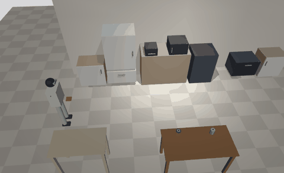
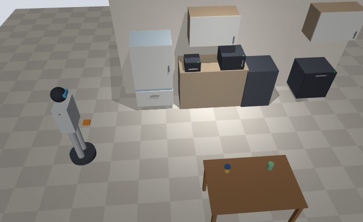

<!-- README_SYNC: source=6d0eef3; updated=2026-11-03 -->
<p align="center">
  简体中文 · <a href="./README_EN.md">English</a>
</p>

<h1 align="center">Robohome</h1>

<p align="center">
  <b>规范不了整个世界，但能规范自己的家。</b><br>
  把家的布局、可操作部件、标准容器、物品台账和联网家电写成一份规范文件，<br>
  机器人照着它按函数调用的方式做家务，不需要先学会理解整个世界。
</p>

<p align="center">
  如果这个思路对你有启发，点一个 <a href="https://github.com/shaojie66/robohome/stargazers">⭐ Star</a>，方便以后回来，也让做家用机器人的人更容易发现它。
</p>

<p align="center">
  <a href="https://github.com/shaojie66/robohome/stargazers"></a>
  <a href="./pyproject.toml"></a>
  <a href="./LICENSE"></a>
  <a href="https://github.com/shaojie66/robohome/commits"></a>
  <a href="https://github.com/shaojie66/robohome/issues"></a>
</p>

<p align="center">
  
  <br>
  <sub>MuJoCo 物理仿真里的"把鸡米花放进空气炸锅并启动"。场景完全由规范文件生成，没有另外建模。</sub>
</p>

> **当前阶段：纯软件验证。** 还没有接真机，家电是模拟的。技能有两种实现：只改内存状态的模拟实现（默认）和 MuJoCo 物理仿真，两者共用同一套规划和调度代码。

## 为什么这样做

通用机器人进家门，最贵的是让它适应每个家都不一样的混乱。Robohome 反过来：先把自己的家"封装"好，就像扫地机第一次建图。

| | 让机器人自己理解家 | Robohome |
| --- | --- | --- |
| 东西在哪 | 每次看、每次猜 | 查台账：哪个容器、在哪个槽位 |
| 门怎么开 | 识别把手、试力度 | 规范文件写好把手位置和门轴方向 |
| 加热、切菜 | 机器人自己上手 | 机器人只开门、传递、按按钮，热和刀交给家电 |
| 大模型的活 | 从感知到动作全包 | 只把一句话拆成技能调用，走动和开关门按固定规矩补全 |
| 出了意外 | 猜着继续 | 失败即停，拍现场照，列出需要人处理的事 |

## 现在能做到什么

以下都可以在仓库里复现：

- **五个家务任务端到端跑通**：看冰箱、冷冻转冷藏解冻、空气炸锅、洗碗机收碗、收拾餐桌。做完检查家里的状态，不只看有没有报错
- **入库闭环**：主人把买回来的东西摆上入库台，说一句"今天买了一斤五花肉、两盒酸奶和一袋苹果"，机器人读标签、认出每件是什么，逐件装进对应温区的标准容器，台账记下位置；认不出、放不下的留在台上告诉主人
- **26 个故障用例都能安全停下**：家电离线、门卡住、东西滑落、台账和现实对不上等，模拟实现和 MuJoCo 仿真里都通过
- **本地大模型优先**：默认 Ollama + `qwen3:8b`，不需要 API Key。作者在 Mac 上验收：五个家务任务、三句买菜描述各连跑 20 次全部通过，单次最慢约 2 分钟。也可以换成 Claude
- **入库预览**：不让机器人动手时，也可以只看识别和分配结果，确认后才写台账
- **仿真从规范文件直接生成**：写上存放区和家电的尺寸，就能搭出柜体、抽屉、带门轴的门，门要真的拉开，东西真的会掉

## 快速开始

需要 Python 3.10+。默认安装没有任何第三方依赖。

```bash
git clone https://github.com/shaojie66/robohome.git && cd robohome
pip install -e ".[dev]"

robohome validate                       # 校验样例厨房 data/kitchen_example.json
robohome mvp                            # 五个家务任务和三个入库任务各跑一次，并检查做完后家里的状态
robohome run "把牛肉拿出来解冻"          # 端到端跑一条指令
```

`robohome mvp` 的最后几行应当是：

```
共 8/8 通过
```

再试试故障和入库：

```bash
robohome run "把牛肉拿出来解冻" --fault offline:microwave   # 家电离线
robohome run "把牛肉拿出来解冻" --fault missing:box_f1      # 台账和现实不一致
robohome mvp --faults                   # 每个任务注入几种故障，检查是否安全停下
robohome intake "今天买了一斤五花肉、两盒酸奶和一袋苹果"   # 入库（只预览）
robohome intake "今天买了一斤五花肉、两盒酸奶和一袋苹果" --run   # 入库闭环：机器人逐件装盒、放进对应温区
robohome skills                         # 技能清单（带参数 Schema，规划层用它约束大模型）
pytest
```

### 用本地大模型

```bash
ollama pull qwen3:8b
robohome run "牛肉化一下，晚上要用" --planner local
robohome intake "刚从超市回来，买了排骨、虾仁和一箱牛奶" --recognizer local --run --sim --record out/
```

任何兼容 OpenAI Chat Completions 接口的服务都能用（llama.cpp server、vLLM、LM Studio），用 `--base-url` 指过去。用 Claude 要装 `.[claude]` 并设 `ANTHROPIC_API_KEY`，然后换成 `--planner claude`。

### 用物理仿真

```bash
pip install -e ".[sim]"                 # MuJoCo + Pillow
robohome mvp --sim                      # 八个任务在仿真里跑
robohome mvp --sim --faults             # 故障交给物理去体现
robohome mvp --sim --record out/        # 每次执行录成 GIF
```

没有显示器的 Linux 上渲染要装 OSMesa（`apt install libosmesa6`）；渲染不可用时只跑物理，不出图。

更多命令、故障清单和仿真细节见 [docs/how-it-works.md](./docs/how-it-works.md)。

## 怎么工作

<p align="center">
  
</p>

```
一句话指令
   │
   ▼
规划层 planner/      大模型（或规则）只写实质动作：取、放、倒、拍照、启动家电
   │                 builder 按规矩补上走动和开关门，先在世界副本上预演，失败就带着原因重规划
   ▼
调度器 scheduler/    每一步依次过：安全规则 → 技能前置条件 → 执行；任何一关失败立刻停
   │
   ▼
技能库 skills/       navigate / open / close / pick / place / inspect / pour / appliance / stow / notify
   │                 模拟实现，或 --sim 时在 MuJoCo 里真做
   ▼
家里的规范 spec/      房间与点位、部件、存放区、标准容器、物品台账、家电（appliances/ 统一 call 接口）
```

大模型只负责"想"，不直接动手。停下之后，机器人先拍现场照，关好自己打开的门；关不上的门、手里的东西、掉在地上的东西，单独列给主人。

| 目录 | 做什么 | 现状 |
| --- | --- | --- |
| `spec/` | 家用规范数据层 | 数据结构 + 引用校验 + 厨房样例 |
| `skills/` | 技能库，每个技能 = 前置条件 + 执行 | 模拟实现；`--sim` 时在 MuJoCo 里真做 |
| `appliances/` | 家电适配，统一的 `call(action, params)` 接口 | 模拟家电；之后接 Home Assistant / 米家 |
| `scheduler/` | 任务队列、安全规则、前置条件检查、失败即停、回报 | 可用 |
| `planner/` | 一句话 → 技能调用序列 | 规则规划器（离线）+ 大模型规划器；入库交给 `planner/intake.py` |
| `intake/` | 识别新物品 → 分配容器 → 更新台账 | 关键词识别（离线）+ 大模型识别（文字、照片、入库台上的标签） |
| `llm/` | 本地模型（Ollama 等）或 Claude，接口一致 | 可用 |
| `sim/` | 从规范文件生成 MuJoCo 场景，录像和拍照 | 八个任务、26 个故障都在仿真里通过 |

## 安全边界

- 机器人不直接接触热源和刀具，只负责"开启和传递"：家电运行时不开它的门、不从里面取放东西
- 不进禁区（例如灶台前）；离开一个点位前关好自己在这里打开的门
- 手里拿着东西时不启动有危险的家电；启动必须给出运行分钟数，不超过规范文件里的 `max_minutes`（默认 30）
- 读不到家电状态时按"可能正在运行"处理；不打断不是机器人自己启动的家电
- 入库时食物只进对的温区，一个容器只装一类东西；机器人不拆包装，一个容器装不下就请主人分装

完整规则见 [安全原则](./docs/how-it-works.md#安全原则)。

## 局限

这些是换真机前要替换或验证的部分：

- 机器人是运动学的：按轨迹移动，不算关节力矩，也不和家具碰撞；够得着范围按常见人形机器人估算
- 抓取用"磁吸"简化，不模拟夹爪；装盒时开盖、放进去、合盖简化成"包装落在容器上就算装进去"
- 家电内部（加热、计时）是模拟的，还没接 Home Assistant 或米家
- 规则规划器只认识五个任务的固定说法和入库；任意说法需要大模型
- 目前只有一份样例厨房，还没在真实的家里建过档

## 路线

1. 数据层 + 技能接口 + 最小调度链路 ✓
2. 大模型规划层 + 入库模块 ✓
3. 调度器完善 + MVP 五个任务端到端，系统性故障测试 ✓
4. 技能库加上 MuJoCo 物理实现，规划和调度代码不动 ✓

第二阶段：

1. 入库闭环：机器人自己装盒、放进对应温区，台账记下位置 ✓
2. 仿真更真：绕开家具走、容器位置有偏差时靠标签定位、按宇树 G1 的公开参数检查够不够得着
3. 手机入口 + 家庭服务器：在家里的电脑上跑服务，手机网页发指令、收回报，只在局域网
4. 开源发布

## 参与

有想法、发现问题，或者想用自己家的布局试一试，直接提 [Issue](https://github.com/shaojie66/robohome/issues)。想跟进后续进展，可以 [Watch](https://github.com/shaojie66/robohome) 这个仓库；觉得有用，[点个 Star](https://github.com/shaojie66/robohome/stargazers)。

## 许可证

[Apache-2.0](./LICENSE)
