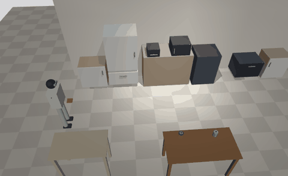
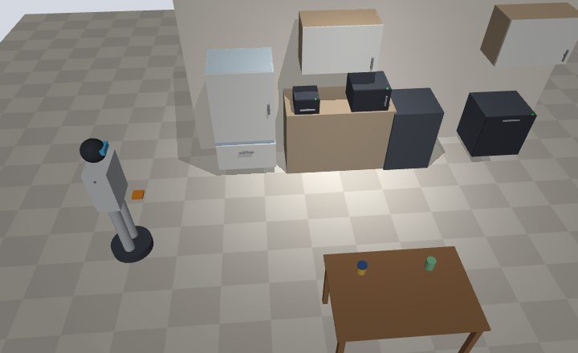

<!-- README_SYNC: source=6d0eef3; updated=2026-11-03 -->
<p align="center">
  <a href="./README.md">简体中文</a> · English
</p>

<h1 align="center">Robohome</h1>

<p align="center">
  <b>You can't standardize the world, but you can standardize your own home.</b><br>
  Describe your home's layout, operable fixtures, standard containers, item inventory and connected appliances in one spec file.<br>
  The robot then does chores as a sequence of function calls, without first having to understand the whole world.
</p>

<p align="center">
  If the idea is useful to you, a <a href="https://github.com/shaojie66/robohome/stargazers">⭐ Star</a> helps you find it again and helps other home-robotics builders discover it.
</p>

<p align="center">
  <a href="https://github.com/shaojie66/robohome/stargazers"></a>
  <a href="./pyproject.toml"></a>
  <a href="./LICENSE"></a>
  <a href="https://github.com/shaojie66/robohome/commits"></a>
  <a href="https://github.com/shaojie66/robohome/issues"></a>
</p>

<p align="center">
  
  <br>
  <sub>"Put the popcorn chicken in the air fryer and start it", in MuJoCo. The scene is generated entirely from the spec file, with no separate modeling.</sub>
</p>

> **Status: software-only.** No real robot yet, and appliances are simulated. Skills have two backends: an in-memory mock (default) and a MuJoCo physics simulation. Both share the same planner and scheduler code.

> The CLI, sample data and messages are in Chinese, because the project is built for Chinese households first. Commands below show the expected input.

## Why

The expensive part of bringing a general-purpose robot home is getting it to cope with how differently every home is arranged. Robohome flips that around: you package your home once, the way a robot vacuum maps a room on its first run.

| | Robot figures out the home | Robohome |
| --- | --- | --- |
| Where things are | Look and guess every time | Look it up: which container, which slot |
| Opening a door | Detect the handle, probe the force | Handle position and hinge side are in the spec |
| Heating, cutting | The robot does it | The robot only opens, carries and presses start; heat and blades stay inside appliances |
| The LLM's job | Everything from perception to motion | Turn one sentence into skill calls; walking and door handling are filled in by fixed rules |
| Something goes wrong | Guess and carry on | Stop, take a photo of the scene, list what needs a human |

## What works today

Everything below is reproducible from this repo:

- **Five household tasks end to end**: check the fridge, move frozen beef to the chiller to thaw, air-fry popcorn chicken, unload the dishwasher, clear the table. Each run checks the resulting state of the home, not just whether it raised an error.
- **Grocery intake, end to end**: put the shopping on the intake counter and say "bought a pound of pork belly, two tubs of yogurt and a bag of apples". The robot reads each label, works out what it is, and stows it into a standard container in the right temperature zone, recording where it went. Anything it can't read or fit stays on the counter and the owner is told why.
- **31 fault cases all stop safely**: appliance offline, stuck door, dropped item, inventory out of sync with reality, a blocked path, a covered container tag, and more. They pass with both the mock backend and the MuJoCo simulation.
- **Local LLM first**: Ollama + `qwen3:8b` by default, no API key needed. On the author's Mac, each of the five household tasks and three grocery sentences passed 20 runs in a row, with the slowest single run around 2 minutes. Claude is supported as an alternative.
- **Intake preview**: without letting the robot move, you can just see what it recognized and which containers it would use; the inventory changes only after you confirm.
- **Phone entry point**: `robohome serve` runs a service on a computer at home. Open it in a phone browser to give instructions, watch each step, and get reports with photos. Things the owner has to decide (an item it can't recognize, an instruction it can't follow, an owner-started appliance that would need stopping) are pushed to the phone and wait for an answer; before stowing groceries it shows where each item would go and waits for "开始装" (start). It only works on the home Wi-Fi, and the inventory and unfinished tasks survive a restart.
- **Simulation generated from the spec**: give storage areas and appliances their dimensions and you get cabinets, drawers and hinged doors. Doors have to be pulled open, and things can actually fall.
- **Simulation sized to the Unitree G1**: hand reach is computed from Unitree's published G1 model (about 0.7 m horizontally at waist height, 1.55 m at most) and checked when the home is set up. The robot plans its walk around furniture for its body size, detours around anything new its lidar sees on the floor, and stops if there's no way through. Containers sit a few centimeters off; the robot finds them by reading the tag on each container with a hand camera.

## Quick start

Requires Python 3.10+. The base install has no third-party dependencies.

```bash
git clone https://github.com/shaojie66/robohome.git && cd robohome
pip install -e ".[dev]"

robohome validate                       # validate the sample kitchen data/kitchen_example.json
robohome mvp                            # run the five household tasks and three intake tasks once and check the home state afterwards
robohome run "把牛肉拿出来解冻"          # one instruction end to end ("take the beef out to thaw")
```

The last line of `robohome mvp` should be:

```
共 8/8 通过
```

(That reads "8/8 passed".) Then try faults and intake:

```bash
robohome run "把牛肉拿出来解冻" --fault offline:microwave   # appliance offline
robohome run "把牛肉拿出来解冻" --fault missing:box_f1      # inventory doesn't match reality
robohome mvp --faults                   # inject several faults per task and check it stops safely
robohome intake "今天买了一斤五花肉、两盒酸奶和一袋苹果"   # intake (preview only)
robohome intake "今天买了一斤五花肉、两盒酸奶和一袋苹果" --run   # intake loop: the robot stows each item in the right zone
robohome skills                         # skill list with parameter schemas used to constrain the LLM
pytest
```

### With a local LLM

```bash
ollama pull qwen3:8b
robohome run "牛肉化一下，晚上要用" --planner local
robohome intake "刚从超市回来，买了排骨、虾仁和一箱牛奶" --recognizer local --run --sim --record out/
```

Any OpenAI Chat Completions compatible server works (llama.cpp server, vLLM, LM Studio); point `--base-url` at it. For Claude, install `.[claude]`, set `ANTHROPIC_API_KEY`, and use `--planner claude`.

### With physics simulation

```bash
pip install -e ".[sim]"                 # MuJoCo + Pillow
robohome mvp --sim                      # all eight tasks in simulation
robohome mvp --sim --faults             # faults happen physically
robohome mvp --sim --record out/        # record every run as a GIF
```

Headless Linux needs OSMesa for rendering (`apt install libosmesa6`); without rendering it still runs the physics, just without images.

### From your phone

```bash
robohome serve                          # run the home service (standard library only)
robohome serve --sim --planner local    # act in simulation so reports carry photos; local model plans and reads labels
```

It prints an address such as `http://192.168.1.8:8765/?key=…`. Open it on a phone connected to the same Wi-Fi and the pairing code is remembered. Inventory, tasks and photos live in `~/.robohome` (change with `--data-dir`), so stopping and starting again picks up where it left off. The page is in Chinese for now.

More commands, the full fault list and simulation details are in [docs/how-it-works.md](./docs/how-it-works.md) (Chinese).

## How it works

<p align="center">
  
</p>

```
one-sentence instruction
   │
   ▼
planner/      The LLM (or rules) writes only the substantive actions: pick, place, pour, photograph, start appliance
   │          builder fills in walking and door handling, dry-runs the plan on a copy of the world, replans with the failure reason
   ▼
scheduler/    Every step passes: safety rules → skill preconditions → execution; any failure stops immediately
   │
   ▼
skills/       navigate / open / close / pick / place / inspect / pour / appliance / stow / notify
   │          in-memory mock, or performed in MuJoCo with --sim
   ▼
spec/         rooms and waypoints, fixtures, storage areas, standard containers, inventory, appliances (appliances/ exposes one call interface)
```

The LLM only thinks; it never acts directly. After a stop, the robot photographs the scene and closes the doors it opened. Doors that won't close, items still in hand and items on the floor are listed separately for the owner.

| Directory | What it does | Status |
| --- | --- | --- |
| `spec/` | Home spec data layer | Data model, reference validation, sample kitchen |
| `skills/` | Skill library; each skill = preconditions + execution | Mock backend; performed in MuJoCo with `--sim` |
| `appliances/` | Appliance adapters behind one `call(action, params)` interface | Simulated appliances; Home Assistant / Mi Home later |
| `scheduler/` | Task queue, safety rules, precondition checks, fail-stop, reporting | Working |
| `planner/` | One sentence → sequence of skill calls | Rule-based planner (offline) + LLM planner; intake goes to `planner/intake.py` |
| `intake/` | Recognize new items → assign containers → update inventory | Keyword recognizer (offline) + LLM recognizer (text, photo, or labels on the intake counter) |
| `llm/` | Local models (Ollama etc.) or Claude behind the same interface | Working |
| `sim/` | Generate the MuJoCo scene from the spec; floor routing, lidar, tag reading; record video and photos | With containers placed slightly off, all eight tasks and 31 faults pass in simulation |
| `server/` | Home server and phone page: queue, progress, reports, questions for the owner, persistence | Standard library only; LAN only, pairing code required |

## Safety boundaries

- The robot never touches heat sources or blades directly. It only opens and carries: it won't open a running appliance or put things in or take them out.
- It stays out of no-go zones (such as in front of the stove) and closes the doors it opened before leaving a waypoint.
- It won't start a hazardous appliance while holding something; starting one requires a run time no longer than the appliance's `max_minutes` in the spec (default 30).
- If an appliance's state can't be read, it is treated as possibly running. The robot won't interrupt an appliance it didn't start; if it would have to, it asks the owner on the phone first.
- During intake, food only goes into the right temperature zone and each container holds one kind of thing. The robot never opens packaging; if one item doesn't fit a container, the owner is asked to split it.

Full rules: [safety principles](./docs/how-it-works.md#安全原则) (Chinese).

## Limitations

These need replacing or validating before moving to a real robot:

- The robot is kinematic: it follows trajectories and ignores joint torques; no whole-body balance or dexterous hands. Reach is computed statically from the G1 model, walking avoids furniture via a floor map, and the area a door sweeps while opening isn't checked.
- Grasping is simplified to a "magnetic" attach; no gripper simulation. Stowing (open the lid, put it in, close it) is simplified to "the package lands on the container".
- Appliance internals (heating, timers) are simulated, not yet connected to Home Assistant or Mi Home.
- The rule-based planner only knows fixed phrasings of the five tasks plus intake; free-form instructions need an LLM.
- There is one sample kitchen so far; no real home has been packaged yet.
- The phone page uses plain HTTP on the home network with a pairing code; there are no accounts or encryption yet, and no access from outside the home.

## Roadmap

1. Data layer + skill interface + minimal scheduling path ✓
2. LLM planning layer + intake module ✓
3. Scheduler hardening + five MVP tasks end to end, systematic fault tests ✓
4. MuJoCo physics backend for the skill library, planner and scheduler unchanged ✓

Phase 2:

1. Grocery intake loop: the robot stows new items into the right zone itself and records where they went ✓
2. More realistic simulation: walk around furniture, find containers by their tags when they're slightly off, check reach against Unitree G1's published model ✓
3. Phone entry point + home server: run the service on a computer at home, send instructions, get reports and answer the robot's questions from a phone browser, LAN only ✓
4. Open-source release

## Get involved

Ideas, bugs, or want to try it with your own home's layout? Open an [Issue](https://github.com/shaojie66/robohome/issues). To follow progress, [Watch](https://github.com/shaojie66/robohome) the repo; if it's useful, [give it a Star](https://github.com/shaojie66/robohome/stargazers).

## License

[Apache-2.0](./LICENSE)
